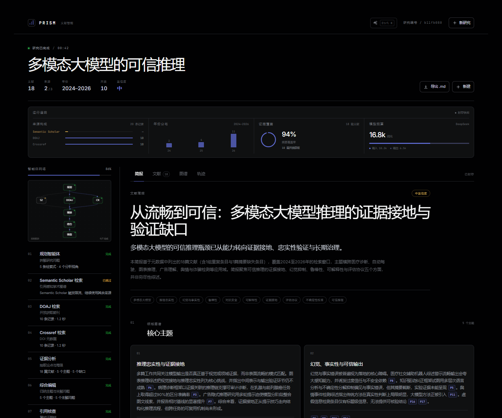
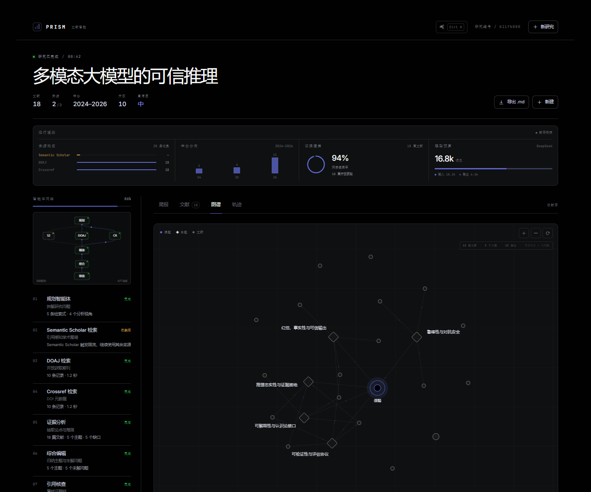
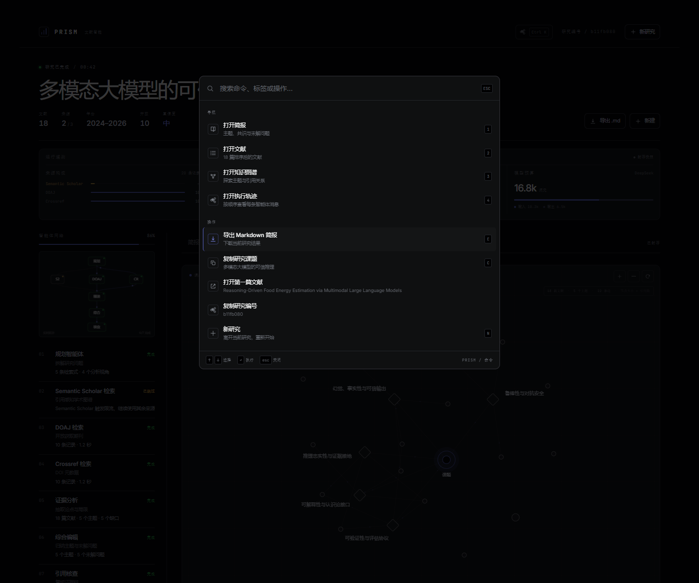

# PRISM

[](https://github.com/2085645319-cmd/paper-prism/actions/workflows/ci.yml)

**面向论文写作的文献智能。**  
输入一个研究课题，PRISM 用多智能体把检索、阅读、归纳和引用复核串成一条可追踪的研究链，输出一份能直接带进写作的文献简报。

> MVP 0.2 · React + Vite · Node/Express · DeepSeek API · Semantic Scholar / DOAJ / Crossref

**在线体验：** https://prism-7z6p.onrender.com

## Preview







## v0.2 前端升级

- **Command palette**：`⌘K` / `Ctrl+K` 搜索并执行跳转、导出、复制、打开论文等动作
- **Live Agent Mesh**：左侧 Canvas 拓扑实时显示 7 个 agent 的状态与数据流
- **Run telemetry**：来源分布、年份分布、摘要覆盖率、prompt/output token 预算
- **Knowledge graph**：Canvas 力导向图 + 链路流动粒子 + 主题标签径向排布 + 拖拽/缩放/聚焦
- **Keyboard-first**：`1–4` 切 tab、`E` 导出、`N` 新研究、`Esc` 关闭浮层
- **Micro-motion**：tab 切换、主题卡/痛点卡的 stagger reveal、滚动进度线
- **全中文界面**：导航、按钮、状态、画布、错误提示与质量闸门全部中文；论文标题/摘要保留原文语言，英文检索式收进可展开的“检索式”面板

---

## 它解决什么

传统文献检索给你一屏链接。PRISM 给你：

- **核心主题**：3–5 条有论文证据的主题线，而不是摘要堆叠
- **领域共识与分歧**：哪些结论已经被多篇论文支持，哪些仍在拉扯
- **未解问题**：带证据编号的 pain points，以及可切入的 research angle
- **阅读路径**：按进入领域的顺序排好 5–7 篇关键论文
- **原文入口**：每篇论文保留 DOI / 出版社 / 开放获取链接
- **可导出简报**：一键导出 Markdown，直接进入写作、组会或 proposal

## 多智能体架构

```text
                    ┌──────────────┐
   topic ──────────▶│   Planner    │  5 个英文检索 query + 4 个分析镜头
                    └──────┬───────┘
                           │
        ┌──────────────────┼──────────────────┐
        ▼                  ▼                  ▼
 ┌────────────┐    ┌────────────┐    ┌────────────┐
 │  S2 Scout  │    │   DOAJ     │    │ Crossref   │   三路 Scout 并行检索
 │  Scout     │    │  Scout     │    │  Scout     │
 └─────┬──────┘    └─────┬──────┘    └─────┬──────┘
       └──────────────────┼──────────────────┘
                          ▼
                 ┌─────────────────┐
                 │  Dedupe + Rank  │  DOI / 标题去重；引用、时效、摘要、相关度加权
                 └────────┬────────┘
                          ▼
                 ┌─────────────────┐
                 │ Evidence Analyst│  逐篇抽取 method / finding / limitation
                 └────────┬────────┘
                          ▼
                 ┌─────────────────┐
                 │ Synthesis Editor│  主题、共识、分歧、未解问题、阅读路径
                 └────────┬────────┘
                          ▼
                 ┌─────────────────┐
                 │ Citation Critic │  引用解析、摘要覆盖、来源广度、模式检查
                 └────────┬────────┘
                          ▼
                    Research Brief
```

前端通过 SSE 订阅每个 agent 的 `stage` 事件，实时显示流水线状态；如果某个源不可用，任务会降级继续，并在界面上标出，而不是整次检索失败。

## 快速开始

```bash
cd paper-prism
npm install
npm run build
npm start
```

打开 **http://127.0.0.1:8790**。

### DeepSeek Key

按以下顺序解析，**不会把 key 发到浏览器**：

1. 环境变量 `DEEPSEEK_API_KEY`
2. 项目根目录 `.env`（参考 `.env.example`）
3. 本机 DSH 的 `~/.dsh/.credentials.yaml` 中的 `DEEPSEEK_API_KEY`

没有 key 时，检索仍然可用，但分析会降级为启发式摘要，并在界面标注 `启发式模式`。

```bash
# .env
DEEPSEEK_API_KEY=你的Key
DEEPSEEK_MODEL=deepseek-chat
CONTACT_EMAIL=you@example.com
PORT=8790
```

### 开发模式

```bash
# terminal 1 — API
npm run dev

# terminal 2 — Vite HMR
npm run dev:client
```

Vite 开发地址是 `http://127.0.0.1:5173`，`/api` 会代理到 `127.0.0.1:8790`。

### 在线部署

[](https://render.com/deploy?repo=https://github.com/2085645319-cmd/paper-prism)

推荐用 **Render** 的免费 Web Service：

1. 点击上面的 **Deploy to Render**，登录并授权 GitHub
2. 选择 Free plan
3. 在环境变量里填 `DEEPSEEK_API_KEY`
4. Deploy

`render.yaml` 已声明：

- `HOST=0.0.0.0`（云端必须监听所有网卡）
- `NODE_VERSION=24`
- build：`npm ci && npm run build`
- start：`npm start`
- health check：`/api/health`

免费实例闲置后会休眠，首次打开需要冷启动；需要稳定在线可以升级 Render 付费实例，或用 Railway / Fly.io / VPS。

也提供了 Dockerfile：

```bash
docker build -t prism .
docker run -p 8790:8790 -e DEEPSEEK_API_KEY=你的Key prism
```

> GitHub Pages 只能托管静态文件，不能运行这个项目的 Express + SSE + DeepSeek 后端。

## 目录

```text
paper-prism/
├─ server/
│  ├─ index.mjs                 # Express API + SSE + static dist
│  ├─ config.mjs                # env / DSH credential resolution
│  ├─ agents/
│  │  ├─ orchestrator.mjs       # stage DAG, event stream, result assembly
│  │  ├─ planner.mjs
│  │  ├─ scout.mjs              # 3 parallel source agents
│  │  ├─ analyst.mjs
│  │  ├─ synthesizer.mjs
│  │  └─ critic.mjs
│  ├─ providers/                # Semantic Scholar / DOAJ / Crossref normalizers
│  └─ lib/                      # DeepSeek client, prompts, ranking, jobs
├─ src/
│  ├─ App.tsx                   # home / research workspace state machine
│  ├─ components/               # canvas field, orbit, graph, brief, papers, trace
│  ├─ styles.css                # dark SaaS design system
│  └─ types.ts
├─ scripts/
│  ├─ smoke.mjs                 # end-to-end API smoke test
│  ├─ flow.mjs                  # Playwright: submit → brief → papers → graph screenshots
│  └─ mobile.mjs
└─ artifacts/                   # generated screenshots / smoke result
```

## API

| Method | Path | Purpose |
|---|---|---|
| `GET` | `/api/health` | LLM / source availability |
| `POST` | `/api/research` | `{ "topic": "..." }` → `{ id }` |
| `GET` | `/api/research/:id/events` | SSE event stream |
| `GET` | `/api/research/:id` | snapshot (reconnect / debug) |

SSE event types: `stages`, `stage`, `plan`, `papers`, `analysis`, `brief`, `review`, `usage`, `warning`, `error`, `done`.

## 设计

采用 **Dark SaaS / Linear-inspired** 设计语言：

- 画布 `#010102`，逐级提亮的炭黑表面，1px hairline 分隔
- 单一强调色 `#5e6ad2`，只用于 CTA、焦点和引用
- Inter + JetBrains Mono，标题负字距，技术文档级信息密度
- 无大面积渐变、无重投影、无玻璃拟态
- Canvas：首页背景星座场、Agent Mesh 仪器、旋转 field instrument、文献知识图谱
- 数据可视化：来源条形图、年份直方图、摘要覆盖率圆环、token 预算分割条

## 快捷键

| Key | Action |
|---|---|
| `⌘K` / `Ctrl+K` | Open command palette |
| `/` | Focus research topic |
| `1` `2` `3` `4` | Brief / Papers / Graph / Trace |
| `E` | Export current brief |
| `N` | New research |
| `Esc` | Close drawer / palette |

## 验证

先在一个终端启动已构建的服务，再在另一个终端跑真实端到端测试：

```bash
# terminal 1
npm run build
npm start

# terminal 2
npm run test:smoke -- "多模态大模型的可信推理"
```

`test:smoke` 会真实调用三路检索与 DeepSeek，约 45–80 秒，并把完整结果写入 `artifacts/smoke-result.json`。

截图脚本（需要本机 Edge）：

```bash
node scripts/flow.mjs
node scripts/mobile.mjs
```

## MVP 边界

- 检索源是**元数据 + 摘要**，没有抓取 PDF 全文；对摘要缺失的文献只做标题级归类。
- Semantic Scholar bulk 接口可能返回较大的响应；已设置超时、重试与 graceful fallback。
- 没有用户系统、数据库和长期保存；每次运行是独立的内存任务。
- 引用复核是**结构检查**（ID、阅读路径、摘要覆盖、来源广度），不是人工事实核查。
- 不是系统综述（systematic review），不能替代研究者对原文的阅读。

## 下一步

1. PDF 上传 / 全文解析与章节级证据定位
2. Semantic Scholar / OpenAlex API key 与引用图扩展
3. Zotero / BibTeX / RIS 导入导出
4. 会话持久化、项目空间与团队协作
5. 多轮追问：针对某个 pain point 继续检索反证
6. 评估集：用人工标注的 topic → gap 对照，量化摘要忠实度

---

PRISM / MVP 0.2 · Research is a loop, not a lookup.
